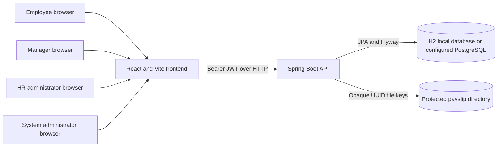
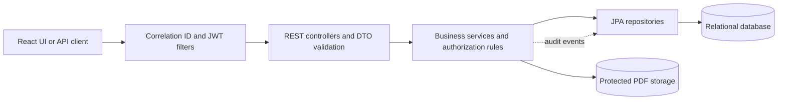
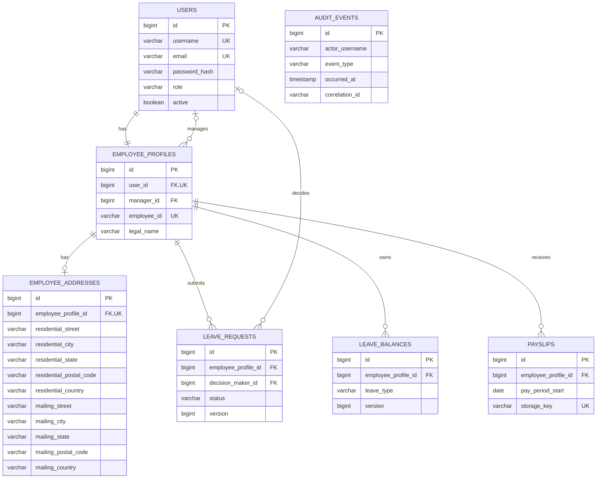

# Architecture, data model, and security

## Context and trust boundaries

The browser is an untrusted client. The frontend provides navigation and
validation for usability, while Spring Security and service-level ownership
checks enforce permissions. Payslip bytes are not served as frontend assets:
the API resolves an opaque database key only after authenticating the employee
and verifying ownership. HR is the only role allowed to provision a payslip;
the system administrator role has no payslip upload permission.

## Application layers and request flow

Controllers bind and validate request data; services own business rules and
transactions; repositories persist entities. API responses use DTOs rather
than exposing JPA entities. Failures use the shared response shape and include
a correlation ID in both the response body and `X-Correlation-ID` header.

## ER diagram

`AUDIT_EVENTS.actor_username` is a logical actor reference; it is deliberately
not a foreign key so historical audit records remain after account archival.

Flyway owns schema changes in `backend/src/main/resources/db/migration`.
Important uniqueness and relationship constraints are enforced in the
database. Leave requests and balances use optimistic versions; leave approval
also locks the affected employee/balance while applying balance changes.
Business records are deactivated or retained for audit rather than physically
deleted. Audit events are append-only through the application API (there is no
ordinary-user read, update, or delete endpoint).

## Decisions and timestamp policy

1. **Keep payslip content outside public assets.** The database stores metadata
   and a generated UUID filename, not an uploaded path or client filename.
   Uploads are limited to 10 MiB, require a `%PDF-` signature, and are committed
   with metadata in one database transaction. A rollback removes the staged
   file. Downloads require employee ownership and use attachment disposition
   plus `Cache-Control: no-store`.
2. **Use stateless bearer JWTs for the local web client.** Requests carry the
   token in the `Authorization` header, not a URL or cookie, so CSRF protection
   is disabled for this stateless API. Logout invalidates the token in the
   running backend; the frontend also clears its local token.
3. **Use the verified principal as ownership identity.** Employee profile,
   address, leave, and payslip operations do not accept client-supplied user
   IDs as a substitute for the authenticated principal.

New `LocalDateTime` values are written using UTC. Existing database timestamp
values have no timezone column; migrations preserve historical values rather
than guessing their original timezone. Pay period dates are calendar dates,
not instants.

## Security controls and limitations

- Passwords use BCrypt and are never returned by API DTOs. Locally provisioned
  passwords must be 12-72 characters. Demo accounts are fictional and
  opt-in.
- Roles are checked server-side; manager decisions are scoped to assigned
  employees. System administrators cannot use the employee payslip endpoint or
  HR upload operation.
- Login attempts are rate-limited. Important authentication, administration,
  address, leave, and payslip actions are written to `audit_events`. Address
  audit entries store SHA-256 snapshots rather than address values.
- Request validation and centralized error handling avoid returning stack
  traces or SQL messages. Errors include a correlation ID. React renders
  ordinary text as text rather than injecting HTML.
- The default H2 database and payslip directory are for local development.
  Filesystem permissions and backups must be protected by the deployment
  operator. At-rest encryption, malware scanning, and production key
  management are not configured here.
- JWT revocation and login rate limits are in-memory and apply to one running
  backend instance. Production multi-instance deployments need shared
  revocation/rate-limit storage. The browser stores its bearer token in
  `localStorage`; an XSS vulnerability could expose it, so production should
  consider a hardened same-site secure-cookie design and corresponding CSRF
  controls.
- The HR upload accepts finalized PDF statements. Salary calculation,
  payslip PDF generation, antivirus scanning, and payroll-system integration
  are outside this project's current scope.
- Dependency scan and concurrent-load benchmark results must be recorded for
  the target deployment; this repository does not claim a production security
  certification or a production capacity guarantee.

## Threat model

| Threat | Primary controls | Remaining limitation |
|---|---|---|
| Employee changes an ID to access another employee's records | Ownership is derived from the verified JWT principal; payslip and profile queries are scoped to that employee; negative API tests cover cross-user access | Administrators with HR permissions can see limited HR operational data |
| User invokes privileged operations directly | Server-side role and relationship checks, plus direct API authorization tests | Authorization must be rechecked whenever a new endpoint is added |
| Attacker uploads a malicious or oversized payslip | HR-only upload, request size limits, PDF signature check, opaque generated storage names, path-safe lookup, and per-HR upload throttling | Signature checks are not malware scanning; only trusted HR should upload |
| Stolen or replayed bearer token | Short-lived signed JWTs, database-backed active-account checks, logout revocation, and no token in URLs | Tokens are kept in browser local storage; revocation is in-memory and single-instance |
| Injection or script content in user-controlled fields | DTO validation, parameterized repository queries, sort allow-lists, React text escaping, and negative tests for query injection and stored markup | Client-side rendering safety does not replace server-side input validation |
| Repeated automated requests exhaust login or file-storage resources | Login throttling and per-HR payslip-upload throttling; upload size caps | Buckets are in-memory and per instance; distributed deployments need shared rate limiting |
| Sensitive document or personal data leaks through errors, logs, or caches | Generic error responses with correlation IDs, no-store downloads, restricted DTOs, and hashed address audit snapshots | Operators remain responsible for protecting database and filesystem backups |

The local performance test exercises normal paginated APIs over HTTP using
25 synthetic accounts across all four roles and checks the specified p95
target. Its result is a local baseline, not a production capacity guarantee.
